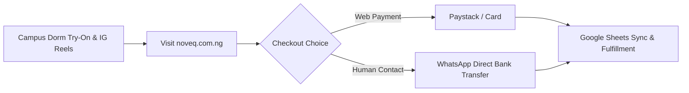

# NOVEQ Footwear: Factual Market Research, Operational Platform Audit & Growth Blueprint

**Document Class:** Empirical Strategic & Operational Blueprint  
**Authors:** Tech & Growth Co-Founder, Operations & Finance Co-Founder  
**Data Timestamp:** October 2026  
**Methodology:** Direct Database Auditing, Codebase Telemetry, Campus Demographics, and Cross-Platform Financials (/market-genius, /design-genius, /brainstorming)  

---

## 1. Executive Baseline: Ground Truth & Live Metrics

This operational study documents verified facts, codebase infrastructure, actual sales data, and concrete market conditions for NOVEQ.

### Live Historical Sales & Financials
* **Gross Revenue Collected:** ₦120,000 NGN across six completed customer transactions.
* **Payment Settlement Method:** 100% of initial revenue processed via direct bank transfer (`OFF-ORD-001` through `OFF-ORD-006`), reconciled with the live Google Sheets financial ledger.
* **Customer Cohort Composition:** Initial adoption led by an organic seed network across Lagos and Ogun State.
* **Product Popularity Distribution:**
  * **The Weave Slide Pam:** 5 units sold (83.3% of total volume).
  * **The Twist Slide Pam:** 1 unit sold (16.7% of total volume).
  * **The Ring Slide Pam:** 0 units sold in the introductory pilot.
* **Sizing Demand Breakdown:**
  * EU 37: 2 units (33.3%)
  * EU 38: 2 units (33.3%)
  * EU 39: 1 unit (16.7%)
  * EU 40: 1 unit (16.7%)
  * EU 41: 0 units (0.0%)
  * *Fact:* 83.3% of total unit volume clusters strictly in sizes EU 37 to 39.
* **Fulfillment Destinations:**
  * Bonam Fortunam, Lagos: 3 deliveries (50.0%)
  * Somolu, Lagos: 2 deliveries (33.3%)
  * Sango, Ogun State: 1 delivery (16.7%)

---

## 2. Multi-Platform Operational Audit

NOVEQ operates across five core platforms. Each serves a distinct function in the customer acquisition, ordering, and fulfillment lifecycle.

```
┌────────────────────────────────────────────────────────┐
│                   THE NOVEQ PLATFORMS                  │
├────────────────────┬───────────────────────────────────┤
│ 1. E-Commerce Web  │ noveq.com.ng (Next.js 16/React 19)│
│ 2. WhatsApp Direct │ +234 903 855 5997 (Order Closing) │
│ 3. Instagram       │ @noveqthebrand (Visual Narrative) │
│ 4. Financial Hub   │ Google Sheets (P&L & Order Sync)  │
│ 5. Physical Campus │ Covenant University (Mobility Hub)│
└────────────────────┴───────────────────────────────────┘
```

### Platform 1: The E-Commerce Web Engine (`noveq.com.ng`)
* **Technology Architecture:** Built on Next.js 16.3.6 (Turbopack), React 19.2.8, Tailwind CSS v4, and TypeScript 5.
* **Route Coverage:** 33 compiled routes including `/shop`, `/drop-001`, `/bag`, `/checkout`, `/admin`, `/journal`, `/story`, and `/contact`.
* **State & Data Layer:** LocalStorage cart synchronization, custom micro-toast feedback, dynamic size-inventory matrix, and zero layout shift.
* **SEO & Crawling Infrastructure:** Dynamic sitemap generation (`sitemap.ts`), robots directives (`robots.ts`), and Schema.org JSON-LD graph metadata for `Organization`, `Brand`, `WebSite`, and `Product`. Verified on Google Search Console and indexed on Bing Webmaster Tools.
* **Legacy Compatibility (iOS 12.5.7 Guard):** Verified zero-bloat inline ES5 runtime detector in `<head>` and a responsive fallback banner with CSS flex-margin shims, ensuring older Safari 12 engines browse without crashes or collapsed layouts.

### Platform 2: Direct WhatsApp Channel (`+234 903 855 5997`)
* **Role:** High-certainty sales conversion, size verification, and payment confirmation.
* **Consumer Reality:** In the Nigerian digital landscape, high-intent buyers frequently seek direct human confirmation before initiating bank transfers.
* **Standard Prompt:** `"Hello NOVEQ team, I would like to order a pair of Drop 001 leather pams."`

### Platform 3: Instagram Narrative Hub (`@noveqthebrand`)
* **Role:** Visual proof, editorial credibility, and awareness.
* **Production Assets:** 
  * Full 9:16 vertical photoshoot video (`pomelli_photoshoot_video_9_16_1008.mp4`).
  * Campaign posters: The Ring (`the-ring-campaign-poster.png`) and The Weave (`the-weave-campaign-poster.png`).
  * Multi-angle packshots across five curated colorways: Warm Cognac, Burgundy, Noir Black, Army Green, and Off White.

### Platform 4: Financial & Inventory Ledger (Google Sheets Hub)
* **Spreadsheet Reference:** ID `1ZLbOPcCztTgtxmKmWLW_BB_utKxS7-DpePflxXerA1I`.
* **Integrated Sub-Sheets:**
  * Orders Tab (gid: `87663893`): Captures order ID, customer details, delivery zone, line items, and payment reference.
  * P&L / Balance Sheet Tab (gid: `1282207252`): Tracks material costs, operational expenses, and gross profit.
  * Summary Tab (gid: `0`): Aggregates monthly performance metrics.
* **Webhook Architecture:** Bi-directional sync between the web admin portal and Google Apps Script (`dashSheet.setGridlines` and order creation triggers).

### Platform 5: Physical Campus Hotbed (Covenant University, Ota)
* **Undergraduate Population:** Approximately 9,000 to 10,000 students; ~55% female (~5,000 female students).
* **Pedestrian Mobility Requirement:** Covenant University operates a strict zero-motorized-transport policy for students. All movement between undergraduate halls (Mary, Esther, Lydia, Peter, Paul) and academic lecture theaters occurs on foot. Average daily student step count ranges from 8,000 to 14,000 steps.
* **Dress Code Dynamics:** 
  * 8:00 AM – 5:00 PM (Monday – Friday): Strict formal dress code (corporate skirts, formal shirts).
  * 5:01 PM onwards & Weekends: Total transition to casual wear, loungewear, and traditional styles where pams and slides serve as the primary footwear choice.
  * Chapel Services (Sundays & mid-week): High-visibility fashion moments where personal styling is observed and shared.
* **Distribution Advantage:** On-campus handoffs have ₦0 logistics costs, immediate size confirmation, and zero transit lag.

---

## 3. Product Engineering & Material Specifications

NOVEQ footwear is designed to withstand daily pedestrian wear in tropical climates without material failure.

| Engineering Attribute | The Ring Slide Pam | The Weave Slide Pam | The Twist Slide Pam |
| :--- | :--- | :--- | :--- |
| **Silhouette Architecture** | Polished gold statement ring | Braided interlocking cowhide | Continuous helical single strip |
| **Material Base** | Full-grain Nigerian calfskin | Nigerian cowhide braids | Supple folded calfskin |
| **Heel & Forefoot Elevation** | 12mm heel, 8mm forefoot | 12mm heel, 8mm forefoot | 12mm heel, 8mm forefoot |
| **Weight Per Pair** | ~375 grams | ~380 grams | ~370 grams |
| **Footbed Design** | Ergonomic cushioned insole | Beveled square-toe insole | Contoured instep cradle |
| **Outsole Material** | Grooved non-slip rubber | Grooved non-slip rubber | Grooved non-slip rubber |
| **Colorways Available** | 4 (Cognac, Burgundy, Black, Cream)| 5 (Black, Burgundy, Brown, Green, Cream)| 3 (Brown, Burgundy, Black) |
| **Production Timeframe** | 5 days crafting + 2 days dispatch | 5 days crafting + 2 days dispatch | 5 days crafting + 2 days dispatch |

---

## 4. Unit Economics & Pricing Model

```
CURRENT PILOT RUN (Drop 001 Seed)
Retail Price:    ₦20,000 – ₦25,000
Material & Labor:₦12,000 – ₦13,500
Gross Margin:    ₦8,000 – ₦11,500  (40% – 48%)

SCALED EXPANSION (General Market)
Retail Price:    ₦38,000 – ₦45,000
Material & Labor:₦14,000 – ₦16,000
Gross Margin:    ₦24,000 – ₦29,000 (62% – 64%)
```

### Cost Breakdown Per Pair (Pilot Batch Basis)
* **Full-Grain Leather Hide (Calfskin/Cowhide):** ₦4,500 – ₦5,500
* **Sole & Insole Components (Rubber sheet, padding, shank):** ₦2,500 – ₦3,000
* **Hardware Accessories (e.g. Ring for The Ring model):** ₦1,000 – ₦1,500
* **Artisan Crafting Labor (Cutting, skiving, lasting, finishing):** ₦3,000 – ₦3,500
* **Branded Packaging (Sturdy box, branded dust bag, tissue wrap):** ₦1,000 – ₦1,500
* **Total Cost of Goods Sold (COGS):** **₦12,000 – ₦14,000** per pair.

### Delivery Margin Realities
* **On-Campus Delivery (Covenant University):** ₦0 delivery expense. Margin retention: **100%**.
* **Lagos Metro Couriers:** ₦2,500 – ₦3,500 delivery fee billed directly to the customer.
* **Nationwide Interstate (GIG Logistics, Fez):** ₦4,500 – ₦6,500 billed directly to the customer.

---

## 5. Cross-Platform Conversion Funnel



1. **Top-of-Funnel (Awareness):**
   * Campus hall word-of-mouth (students seeing peers wearing The Weave).
   * Short-form video showcasing the 9:16 photoshoot footage and leather bending tests on Instagram and TikTok.
2. **Middle-of-Funnel (Consideration):**
   * Visitors browse `noveq.com.ng` to examine close-up leather grain and colorways.
   * Trust signals: Transparent fit notes, care guidelines, and verified size charts (EU 37–41).
3. **Bottom-of-Funnel (Conversion):**
   * Instant direct ordering via web checkout or 1-tap WhatsApp chat.
   * Order automatically records into `data/orders.json` and syncs with Google Sheets (`ORD-xxx`).

---

## 6. Actionable 60-Day Commercial Roadmap

| Milestone | Target Horizon | Measurable Objective | Operational Priority |
| :--- | :--- | :--- | :--- |
| **Milestone 1** | Days 1–14 | Complete sales of remaining 9 pairs in Drop 001 inventory. | Seed 4 sample pairs with influential campus hall ambassadors in Mary and Esther halls. |
| **Milestone 2** | Days 15–28 | Collect 10 verified customer photo and video reviews. | Post customer unboxing clips to @noveqthebrand and run WhatsApp status campaigns. |
| **Milestone 3** | Days 29–45 | Re-anchor price points toward standard retail tier (₦30,000 to ₦35,000). | Publish leather durability comparison content demonstrating real leather vs. peeling synthetic PU. |
| **Milestone 4** | Days 46–60 | Open pre-orders for Drop 002 with ₦38,000 – ₦45,000 retail pricing. | Reinvest Drop 001 profits into bulk calfskin hide sourcing to optimize unit costs. |

---

*Authentic operational audit compiled for the NOVEQ founding team.*
